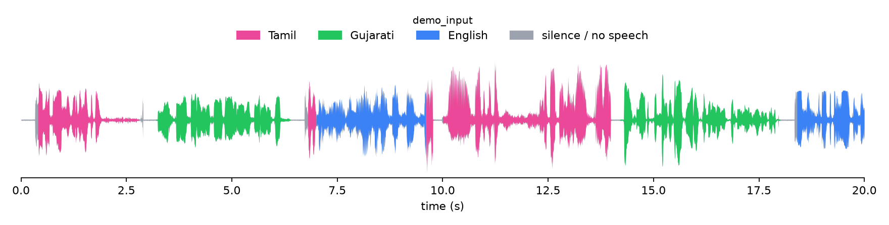

# Indic language diarization

Give it speech that mixes **English and up to two Indian languages** and it tells you **which language is spoken when**:

* an **RTTM file** (`LANGUAGE <file> 1 <start> <dur> <NA> <NA> <LANG> <NA> <NA>`),
* a **picture** of the waveform coloured by language (pink / green = the two Indian languages, blue = English, grey = silence),
* **one pooled audio file per language** (all English speech joined into `*_EN.wav`, all Tamil speech into `*_TA.wav`, ...),
* a small **web app** (free, Gradio) that does all of the above from a browser.



*The picture above is 20 s of a constructed demonstration recording (English + Tamil + Gujarati, built from held-out VoxLingua107 clips).*

Supported languages (14): English, Assamese (`as`), Bengali (`bn`), Gujarati (`gu`), Hindi (`hi`), Kannada (`kn`), Malayalam (`ml`),
Marathi (`mr`), Nepali (`ne`), Punjabi (`pa`), Sanskrit (`sa`), Tamil (`ta`), Telugu (`te`), Urdu (`ur`).
These are the languages that are both in the CLSRIL-23 pre-training data and in VoxLingua107 (the source of the training speech).
The other languages in CLSRIL-23's list (Bodo, Dogri, Maithili, Konkani, Manipuri, Odia, Santali, Kashmiri) are not in VoxLingua107
and are **not** supported.

> **Please read the "How good is it?" section before relying on the output.**

---

## Quick start

```bash
git clone https://github.com/hsharma9710-star/indic-language-diarization.git
cd indic-language-diarization
pip install -r requirements.txt            # PyTorch + transformers + soundfile ... (ffmpeg needed for mp3/mp4)

# 1. get the model weights (433 MB) from the GitHub release of this repository and put them in ./weights/
mkdir -p weights && curl -L -o weights/diarizer.pt \
  https://github.com/hsharma9710-star/indic-language-diarization/releases/download/v1.0/diarizer.pt

# 2. diarize a file
python -m ildiar.cli my_speech.wav -o out/ --languages ml kn      # you know the languages (recommended)
python -m ildiar.cli my_speech.mp3 -o out/                        # or let the tool detect them
```

Outputs in `out/`:

| file | content |
|---|---|
| `<name>.rttm` | language segments, one per line |
| `<name>_languages.png` | coloured waveform picture (first 20 s by default; `--plot-window 30 50` for seconds 30–50) |
| `<name>_EN.wav`, `<name>_TA.wav`, ... | pooled audio, one file per language found |

Useful options: `--languages ml kn` (1 or 2 ISO codes), `--device cpu|cuda`, `--rttm-codes family` (writes Kannada as `KA`),
`--smooth 5` (smoother, slightly less accurate), `--no-split`.

Python:

```python
from ildiar.engine import Diarizer
from ildiar.outputs import write_rttm
d = Diarizer("weights/diarizer.pt")
r = d.diarize("my_speech.wav", languages=["ta", "gu"])      # languages=None -> detect
write_rttm(r["segments"], r["name"], "out.rttm")
print(r["segments"][:3])     # [(start_s, duration_s, class_id), ...]
```

## Website (free)

```bash
pip install -r requirements.txt gradio
python app.py            # open http://127.0.0.1:7860
```

To put it online **for free**, create a [Hugging Face Space](https://huggingface.co/spaces) (SDK *Gradio*, hardware *CPU basic*, no payment),
upload this repository's files, and either upload `diarizer.pt` into the Space's `weights/` folder (Git LFS) or set the Space variable
`ILDIAR_WEIGHTS_URL` to the release URL above. CPU inference took about 6 s per minute of audio on a 32-core server CPU (measured); the free Space has only 2 vCPUs, so
expect it to be several times slower (not measured). The app refuses files longer than 10 minutes (`ILDIAR_MAX_SECONDS`).

## How it works

```
audio (16 kHz) ──► CLSRIL-23 wav2vec 2.0 encoder, fine-tuned (768-d every 20 ms)
                ──► statistical pooling over 10 frames (mean ‖ std → 1536-d per 200 ms)
                ──► FC 1536→3000→256  +  4-block self-attention (4 heads, d=256, FFN 2048)
                ──► 15-way class per 200 ms: silence, English, 13 Indian languages
                ──► keep English + the (≤2) Indian languages present  ──► segments ──► RTTM
```

* Architecture follows Mishra, Patil, Chowdhury, Prasanna, *"End to End Spoken Language Diarization with Wav2vec Embeddings"*,
  Interspeech 2023 (pooling + embedding + self-attention head, joint loss), extended from 3 to 15 classes.
* Stage-2 fine-tuning of CLSRIL-23 with a **cross-entropy** loss on the 200 ms language tags (the paper uses CTC; both were trained and
  compared, see `docs/RESULTS.md`).
* **Training data is synthetic**: monolingual VoxLingua107 clips cropped, alternated and joined (English + one or two Indian
  languages per utterance, 110 h), with energy-VAD-derived silence. No real code-switched speech was used for training.
* Audio longer than 30 s is processed in 30 s chunks (the length the network was trained and tested on).

## How good is it?

Measured with the **diarization error rate on 200 ms bins, no collar** (stricter than the usual NIST DER with its 250 ms forgiveness
collar): *(speech bins with the wrong or missed language + silence bins labelled as speech) ÷ reference-speech bins*.

| Test | Languages | DER |
|---|---|---|
| **27 real recordings** (15 English + Malayalam, 12 English + Kannada, 21 h, never used for training or model selection) | named by the user (`--languages`) | **25.7 %** |
| same recordings | detected automatically | **29.4 %** |
| synthetic held-out development set (6.7 h, English + 1–2 of 13 languages) | detected automatically | 9.2 % |

What this means in practice:

* On **real conversational speech** about one bin in four is wrong, even when you name the languages. Expect good results on
  clean, clearly separated stretches and many errors at fast switches and short turns.
* **Automatic language detection is the weak point**: it found the exact language set in only **56 %** of the real files, usually
  adding a spurious second language that sounds similar (e.g. Telugu/Kannada for Malayalam). If you know the languages, pass `--languages`.
* Performance **varies a lot between recordings** (known-language DER from about 13 % to about 42 %).
* The **three-language case (English + two Indian languages) has only been validated on synthetic data**; no real three-language
  recordings were available. The constructed example above is easy by design.
* Real silence is poorly found (the model was trained on artificial gaps).
* Tested languages on real data: Malayalam and Kannada only. The other 11 languages are validated on synthetic data only.
* The model is a research prototype, not a production system. See `docs/RESULTS.md` for all numbers and limitations.

## Reproducing / retraining

`training/` contains the scripts used to build the synthetic data, fine-tune the encoder (cross-entropy and CTC), train the
head and evaluate (see `training/README.md`). `scripts/evaluate_dir.py` scores the packaged tool on any set of audio + RTTM files;
`scripts/sweep_decoder.py` shows how the automatic language rule was chosen (on synthetic development data, not on the test recordings);
`scripts/score_rttm.py` compares two RTTM files.

## Data, licences and attribution

* Code: MIT (see `LICENSE`).
* Encoder initialisation: **CLSRIL-23** wav2vec 2.0 (Vakyansh / Open-Speech-EkStep, MIT), obtained as the Hugging Face export
  `Harveenchadha/wav2vec2-pretrained-clsril-23-10k`.
* Training speech: **VoxLingua107** (Valk & Alumäe, SLT 2021), CC BY 4.0; the copyright of the underlying YouTube audio remains with
  its owners, so **no VoxLingua audio is redistributed here**.
* Method: Mishra et al., Interspeech 2023.
* The real test recordings (`family_ld`) are private and not part of this repository.

```
@inproceedings{mishra2023w2v_e2e_ld,
  title     = {End to End Spoken Language Diarization with Wav2vec Embeddings},
  author    = {Mishra, Jagabandhu and Patil, Jayadev N and Chowdhury, Amartya and Prasanna, S. R. Mahadeva},
  booktitle = {Proc. Interspeech},
  year      = {2023},
  pages     = {501--505}
}
```
